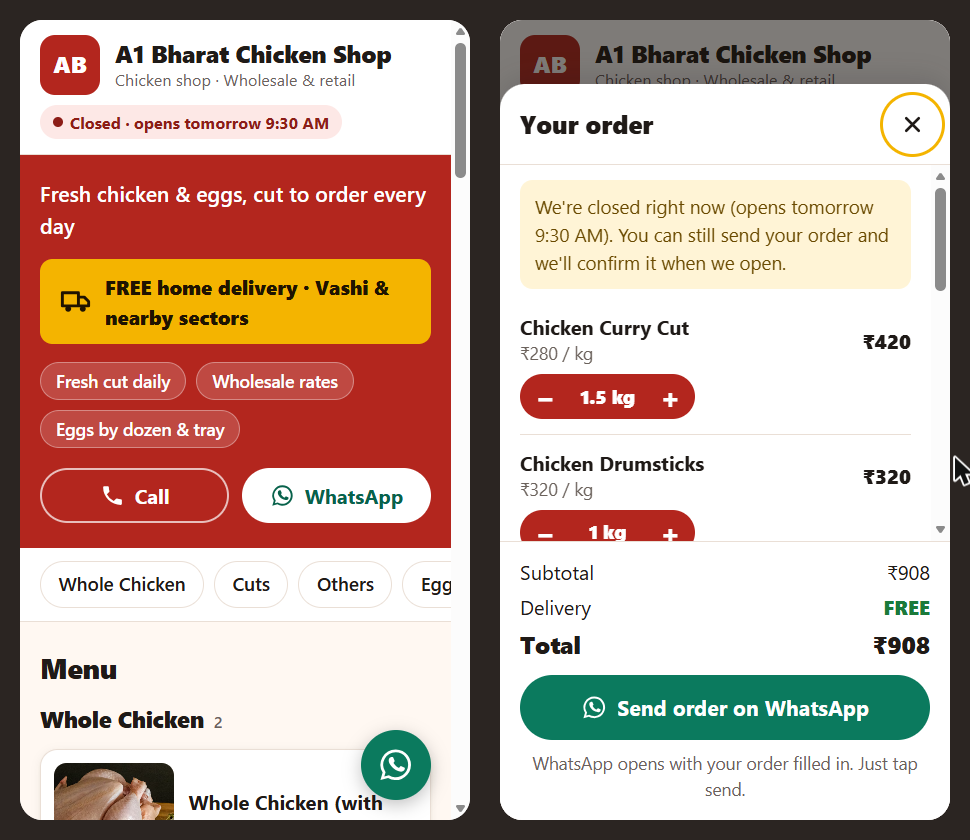

<div align="center">

# Local Shop Menu

A free, open-source website for small local shops: a live menu that the shop edits in Google Sheets, and a cart that sends orders straight to the shop's WhatsApp. Plain HTML, CSS and JavaScript, with no build step and free hosting on Cloudflare Pages.

[](https://opensource.org/licenses/MIT)
[](#overview)
[](tests/logic.test.js)
[](#deploying-to-cloudflare-pages)

</div>

## Why I built this

My father's friend runs A1 Bharat Chicken Shop, a small local chicken shop in Vashi, Navi Mumbai, and asked if I could build him a website. He didn't need an online store with payments and logins. He needed a page where customers could see today's prices and send him an order, and a way for him to change those prices himself without calling me every time.

So I built it around two things he already uses every day: Google Sheets for the menu and WhatsApp for orders. Plenty of other small shops need exactly the same thing, so I made it a general template. Another shop only has to edit one file (`config.js`) and point it at their own Google Sheet.

## Table of Contents

- [Overview](#overview)
- [Screenshots](#screenshots)
- [Features](#features)
- [Installation](#installation)
- [Usage](#usage)
- [Configuration](#configuration)
- [Deploying to Cloudflare Pages](#deploying-to-cloudflare-pages)
- [Troubleshooting](#troubleshooting)
- [Testing](#testing)
- [Contributing](#contributing)
- [Acknowledgements](#acknowledgements)

## Overview

Local Shop Menu is a mobile-first static website for shops that sell from a menu: chicken and meat shops, egg sellers, bakeries, tiffin services, kirana stores. The menu lives in a Google Sheet published as CSV. The site fetches it on every page load, so adding a row, changing a price or marking something out of stock shows up on the site without a redeploy.

Customers add items to a cart (in 0.5 kg steps for items sold by weight), choose pickup or home delivery, and tap **Send order on WhatsApp**. WhatsApp opens with the full order, totals, name and address already typed out. Everything shop-specific (name, hours, address, map, delivery terms, colours) lives in a single `config.js`, and the current `config.js` is the live configuration for A1 Bharat Chicken Shop.

## Screenshots

The menu on a 360px phone, and the cart sheet with free home delivery.

[](docs/screenshot.png)

## Features

- Live menu from a published Google Sheet (CSV), grouped by category in sheet order
- Robust CSV parsing (quoted fields, commas inside text, blank rows, stray spaces, any column order, `₹` and commas in prices)
- Out-of-stock items greyed out or hidden (`available = No`)
- Per-item photos with a neat placeholder for missing or broken images (Google Drive share links are converted automatically)
- Cart with quantity steppers (0.5 steps for `kg`, whole numbers otherwise), sticky cart bar, saved on the phone between visits
- Cart cleanup: items removed from the sheet are dropped from saved carts, with a notice
- Checkout with name, pickup or delivery, address, notes, delivery fee or **FREE delivery**, and a minimum order
- One-tap WhatsApp order (`wa.me`) with items, quantities, line totals and grand total
- Open now / Closed badge from opening hours (split shifts, weekly holidays, overnight hours)
- Address, embedded Google Map, **Get directions**, call button, Google review link, floating WhatsApp chat button
- Accessible (labels, 44px tap targets, keyboard and screen-reader support, AA contrast, reduced motion)
- No dependencies, no framework, no build step; about 12 KB of gzipped JavaScript

## Installation

### Prerequisites

- Any modern browser
- Python 3 **or** Node.js, only to preview locally (any static file server works)
- A Google account for the menu sheet and a GitHub account for deploying

### Setup

```bash
git clone https://github.com/richie-rk/<this-repo>.git
cd <this-repo>

python -m http.server 8000      # or: npx serve .
```

Open <http://localhost:8000>. Don't double-click `index.html`: browsers block `fetch()` from `file://`, so the menu won't load.

With `sheetCsvUrl` empty, the site shows the demo menu from `data/sample-menu.csv`.

## Usage

### Setting up the Google Sheet

Sign in to the Google account that should **own** the menu (ideally the shop owner's own Gmail), then:

1. Open <https://sheets.new> → **File → Import → Upload** → `data/sample-menu.xlsx` → **Replace spreadsheet** → **Import data**.
2. Edit the rows to match the shop's real items and prices.

The `.xlsx` is only a starting point. After importing, the Google Sheet is the real menu, and the site never reads the `.xlsx`.

| Column | Required | Example | Notes |
|---|---|---|---|
| `name` | yes | `Chicken Curry Cut` | Rows without a name are ignored |
| `category` | | `Cuts` | Items are grouped in the order categories first appear |
| `price` | yes | `280` | Number only, the price for one `unit` |
| `unit` | | `kg` | `kg`, `piece`, `dozen`, `tray`, `plate`. `kg` allows 0.5 steps; others whole numbers |
| `available` | | `Yes` | `No` = out of stock. Blank counts as Yes |
| `description` | | `Bone-in pieces` | Optional |
| `imageUrl` | | `https://…` | Optional direct image link or Google Drive share link |

### Publishing it as CSV

1. In the sheet: **File → Share → Publish to web**.
2. Choose the **Menu** sheet and **Comma-separated values (.csv)** → **Publish**.
3. Copy the link (`https://docs.google.com/spreadsheets/d/e/2PACX-…/output=csv`) into `config.js` as `sheetCsvUrl`.

Google caches the published CSV, so **sheet changes can take about 5 minutes to appear** on the site. That's normal. The site already requests a fresh copy on every load, but it can't bypass Google's publishing delay.

### Sharing the sheet with multiple editors

**Share** → add each person's Gmail → **Editor**. Everyone you add can change prices on the live site, so only add people you trust, and never set general access to "Anyone with the link → Editor". **File → Version history** shows who changed what. To stop someone renaming the column headers, protect row 1 via **Data → Protect sheets and ranges**.

If you built the sheet in your own account, you can hand it over: **Share** → open the dropdown next to the owner's name → **Transfer ownership**. They accept from the email, and the published link keeps working.

### Making a copy for another shop

This repository is the template. Each shop gets its own copy that differs **only in `config.js`**:

- **Fork** (copy is public): **Fork** → edit `config.js` → deploy. Get updates with **Sync fork**.
- **Use this template** (copy can be private): **Use this template → Create a new repository** → edit `config.js` → deploy. Get updates by adding this repo as `upstream`:

```bash
git remote add upstream https://github.com/richie-rk/<this-repo>.git
git fetch upstream
git merge upstream/main --allow-unrelated-histories   # first time only
git checkout --ours config.js && git add config.js     # keep your config if it conflicts
git commit && git push
```

## Configuration

`config.js` is the only file a shop edits; `config.example.js` is a blank, commented copy. Leave any optional text as `""` to hide it.

| Setting | What it does |
|---|---|
| `shopName`, `tagline`, `businessType`, `logoUrl` | Header and browser tab. No logo shows an initials badge |
| `phone` | Call buttons |
| `whatsappNumber` | **Required for ordering.** Country code + number, digits only: `918097984544` |
| `googleReviewUrl` | Optional "Rate us on Google" link |
| `highlights` | Short chips under the tagline |
| `delivery` | `enabled`, `free`, `charge`, `freeAbove`, `minOrder`, `note` |
| `openingHours` | `{ timezone, schedule: [{ days: "Mon-Sun", slots: ["09:30-14:30", "18:00-22:00"] }] }`. Later entries override earlier ones (`{ days: "Tue", closed: true }`) |
| `location` | `addressLine`, `area`, `city`, `state`, `pincode`, `landmark`, `latitude`, `longitude`, `googleMapsUrl`, `showMap` |
| `sheetCsvUrl` | Published CSV link. Empty uses `data/sample-menu.csv` |
| `showOutOfStock` | `"greyed"` or `"hide"` |
| `orderMessageTemplate` | First line of the WhatsApp order; `{shopName}` is filled in |
| `theme` | Colours and an optional Google Font |
| `footerCredit` | Footer credit link |

To get latitude and longitude, right-click the shop in Google Maps (long-press on a phone) and click the coordinates to copy them.

## Deploying to Cloudflare Pages

1. Push the repository to GitHub.
2. <https://dash.cloudflare.com> → **Workers & Pages** → **Create** → **Pages** → **Connect to Git** → pick the repo.
3. Framework preset **None**, build command *empty*, output directory `/`.
4. **Save and Deploy**. The site is live at `https://<project>.pages.dev`.

Every push redeploys automatically. Menu changes in the Google Sheet never need a redeploy. To use a custom domain, open the Pages project → **Custom domains** → **Set up a custom domain**; HTTPS is automatic.

## Troubleshooting

| Problem | Fix |
|---|---|
| "We couldn't load the menu right now" | Open `sheetCsvUrl` in a browser. It should show plain comma-separated text. If not, re-publish as **CSV** for the **Menu** sheet |
| Works online, not on my computer | Serve the folder instead of double-clicking `index.html` |
| Sheet changes don't appear | Wait about 5 minutes and reload |
| An item is missing | Its `name` is empty or `price` isn't a number. The browser console (F12) lists skipped rows |
| WhatsApp says the number is invalid | `whatsappNumber` must be digits only with the country code (`91…`) |

## Testing

```bash
node tests/logic.test.js     # CSV parser, quantity steps, opening-hours logic (no dependencies)
```

## Contributing

Contributions are welcome, whether it's a bug fix, a new feature, or a better way for shop owners to manage their menu. Here's the flow I'd like you to follow.

1. Fork the repository and create a branch (`git checkout -b feature/my-change`).
2. Keep it dependency-free and build-free. If it needs npm, it probably doesn't belong here.
3. Keep anything shop-specific in `config.js`, and add new settings to `config.example.js` with a sensible default.
4. Run `node tests/logic.test.js` and check the site at 360px width.
5. Open a pull request describing what changed and why.

If you're not sure whether something is worth doing, open an issue and ask first.

## Acknowledgements

- Cart and WhatsApp ordering inspired by [restaurant-menu-template](https://github.com/younisgaith1-ctrl/restaurant-menu-template).
- Google Sheets–driven menu inspired by [restaurant-menu-webapp-gas](https://github.com/kevin-vaghasiya/restaurant-menu-webapp-gas).
- Demo photos from Unsplash ([JK Sloan](https://unsplash.com/photos/raw-chicken-meat-on-brown-wooden-chopping-board-9zLa37VNL38), [Hayley Ryczek](https://unsplash.com/photos/a-raw-chicken-on-a-cutting-board-with-herbs-and-seasonings-oqZ7gu3ytDg)) and Pexels ([Zehra Yılmaz](https://www.pexels.com/photo/raw-meat-on-a-frying-pan-23359724/), [Julia Filirovska](https://www.pexels.com/photo/fresh-chicken-legs-with-spices-covered-with-grill-grate-7140306/), [Ragil Tagiyev](https://www.pexels.com/photo/raw-chicken-on-a-tray-6281484/)). The curry cut, breast and egg images are third-party links and should be replaced with the shop's own photos.

Built for A1 Bharat Chicken Shop, and for every small local shop that just needs its menu online and orders on WhatsApp.
